# MxGantt

> An enterprise Gantt chart for Mendix: a zoomable timeline next to an editable task list, with dependencies, the
> critical path, baselines, resources, costs and earned value, portfolios, and Excel and MS Project export and import.
> Users reschedule by dragging bars or with the keyboard, and the new dates are written back to your objects.

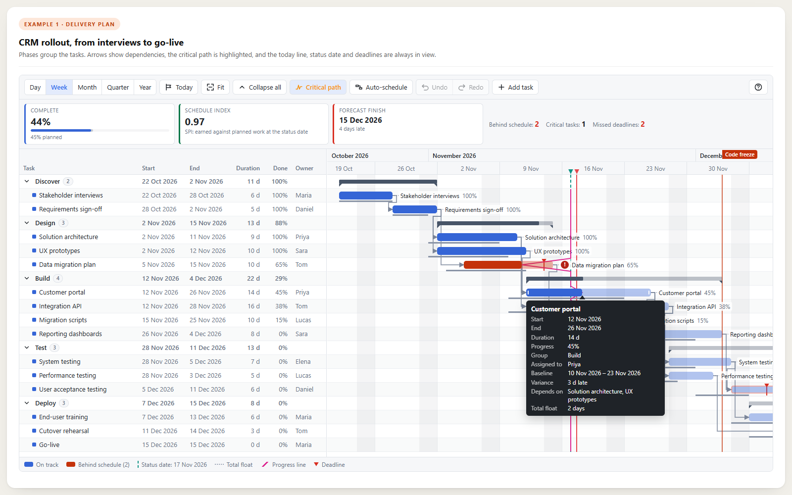

Point MxGantt at a data source of tasks and set four attributes (name, start, end and, optionally, progress) to get a
working chart. Every other feature is optional and off by default, so you switch on only what a page needs. The whole
widget is written from scratch: no commercial Gantt library and no licence key.

- Mendix 11.0 or newer, web only
- Widget id `com.mxtechies.widget.web.mxgantt.MxGantt`, category *Data containers*, version 1.0.0
- License: Apache-2.0. The only bundled third-party package is `classnames` (MIT); see
  [THIRD-PARTY-LICENSES.md](THIRD-PARTY-LICENSES.md).
- Example module with 15 business examples: [MxGanttDemo](https://github.com/bharathidas/MxGanttDemo)

## Installation

1. Download `com.mxtechies.widget.web.MxGantt.mpk` from the
   [latest release](https://github.com/bharathidas/MxGantt/releases/latest) (or from the Mendix Marketplace).
2. Put it in the `widgets` folder of your app.
3. In Studio Pro, press F4 (Synchronize app directory).
4. Drop **MxGantt** on a page, set the **Data source**, **Task name**, **Start** and **End**, and run the app. See
   [Setting it up](#setting-it-up) for the rest.

## Features

**Timeline and task list**
- Year, quarter, month, week and day zoom (toolbar, Ctrl + mouse wheel or Zoom to fit), two header scales, a today
  line, non-working day shading and smooth animated zoom.
- Task list with WBS numbers, start, end, duration, progress, assignees, predecessors, baseline dates, variance, cost
  and earned value columns. Configure any number of attribute columns in Studio Pro, each with its own format, width,
  alignment, totals, dynamic cell class, sorting and inline editing.
- Custom fields: users add their own columns in the running app (text, number, currency, percent, date, single and
  multi-select with colours, checkbox, person, link, rating and formula) without a domain model change.
- Collapsible groups and multi-project portfolios with summary bars, milestones, codes, a second line per row and
  bars coloured by a status attribute, plus a quiet portfolio look for programme boards.

**Scheduling**
- Dependencies of all four types (FS, SS, FF, SF) with lags in days, weeks or hours, conflict flags, the critical
  path and total float.
- Drag to move, resize or set progress, and drag from one bar to another to link them; keyboard moves for everything.
- Auto-scheduling on a working calendar (working days and holidays), the eight MS Project constraint types, a
  Schedule plan forward pass, split tasks and what-if scenarios you can apply or discard.
- Undo and redo for every change, and save-failure recovery with rollback and Retry.

**Tracking**
- Up to ten named baselines per task with a comparison view and variance, deadlines, a status date, a progress line,
  behind-schedule colouring and timeline markers.
- A project health strip (planned against actual, SPI, forecast finish against the baseline) and a portfolio summary
  rating each project On track, At risk or Off track.
- Resource assignments with units, a resource usage histogram with over-allocation in red and resource levelling.
- Costs from fixed costs and hourly rates, and an earned value panel (BAC, PV, EV, AC, CV, SV, CPI, SPI, EAC, ETC and
  VAC) with an S-curve.

**Data in and out**
- Export to PNG, print (ready for Save as PDF), CSV, Excel (.xlsx with outline groups, real dates and numbers) and
  MS Project XML; import MS Project XML into your own entities through a microflow.
- Search, Critical only, Late only, My tasks and custom field filters; the view can be remembered per user.

**Quality**
- Only the rows on screen are drawn, so plans with 5,000 tasks stay fast, and large data sources load in pages.
- Keyboard and screen reader support (WCAG 2.2 AA checks), right-to-left layouts, light and dark themes, reduced motion.
- Every text is a translatable Studio Pro text property, and Studio Pro shows the configured columns in the design
  and structure previews and hides the settings that do not apply.

## Screenshots

| | |
| --- | --- |
|  | 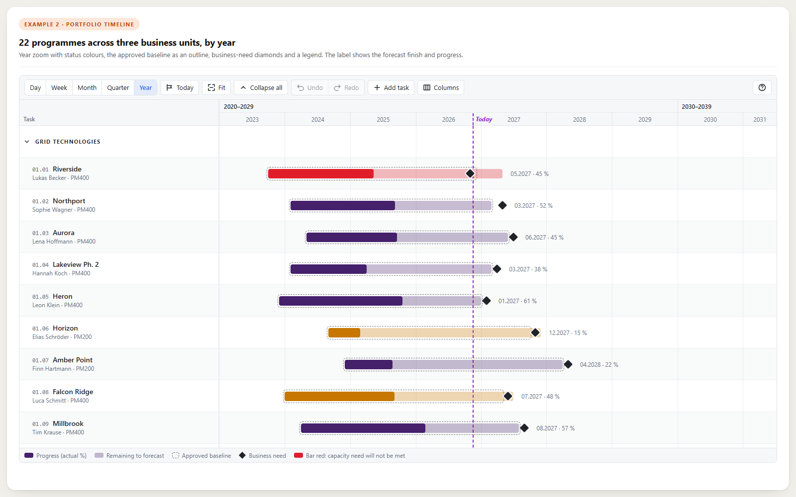 |
| **1. Delivery plan.** Phases, dependency arrows, the critical path, today line, status date, deadlines and a task tooltip. | **2. Portfolio timeline.** Year zoom with status colours, approved baseline outlines, business-need diamonds and a legend. |
| 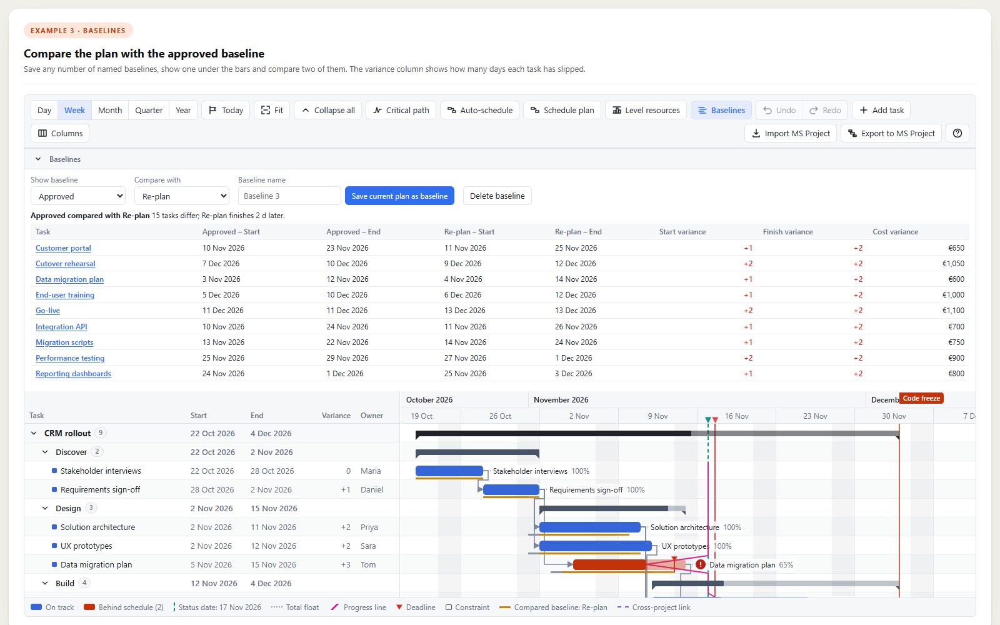 | 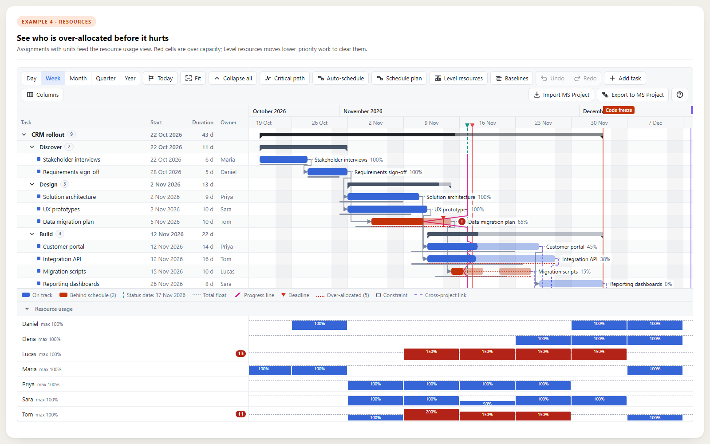 |
| **3. Baselines.** The approved baseline under the bars, compared with a re-plan, with start, finish and cost variance. | **4. Resource usage.** Assignments with units show who is over capacity, next to Level resources. |
| 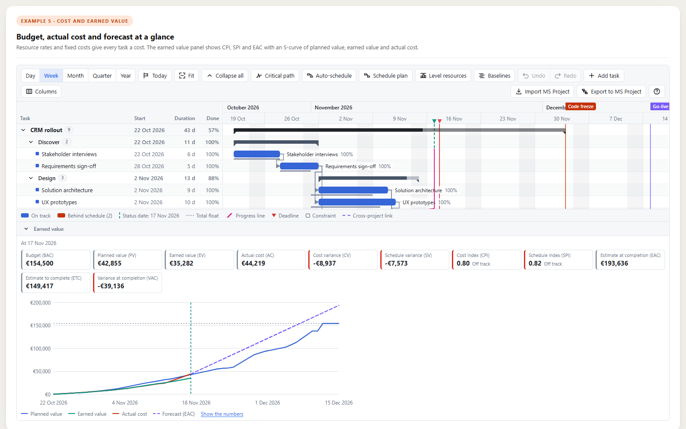 | 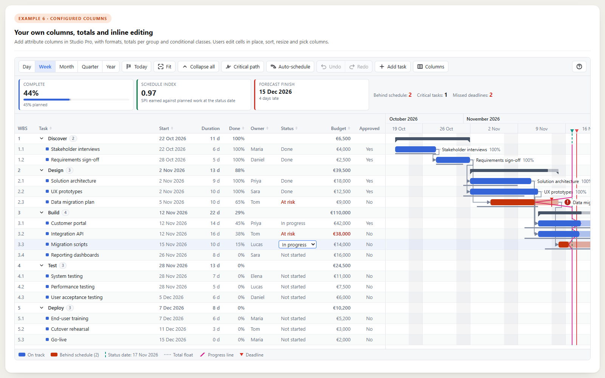 |
| **5. Cost and earned value.** BAC, PV, EV, AC, CPI, SPI and EAC with an S-curve and forecast. | **6. Configured columns.** Owner, Status, Budget with group totals and over-budget highlighting, and inline editing. |
| 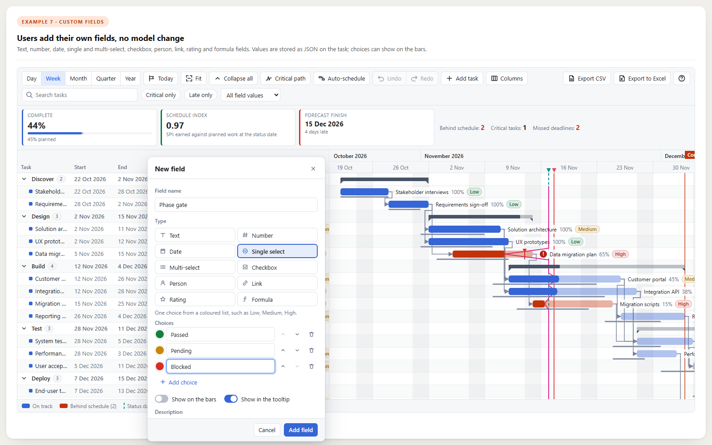 | 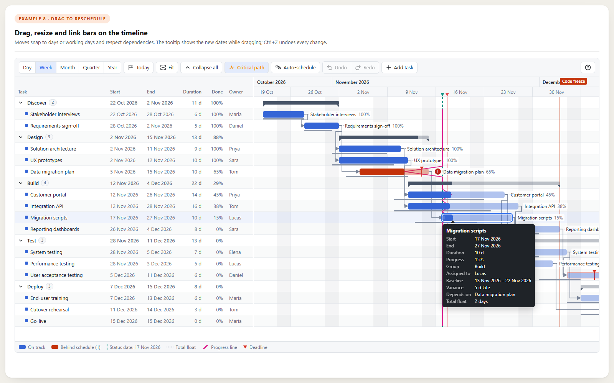 |
| **7. Custom fields.** Users add their own fields, such as a phase gate select with coloured choices. | **8. Drag to reschedule.** A bar mid-drag with the live dates; dependencies and undo are kept. |
| 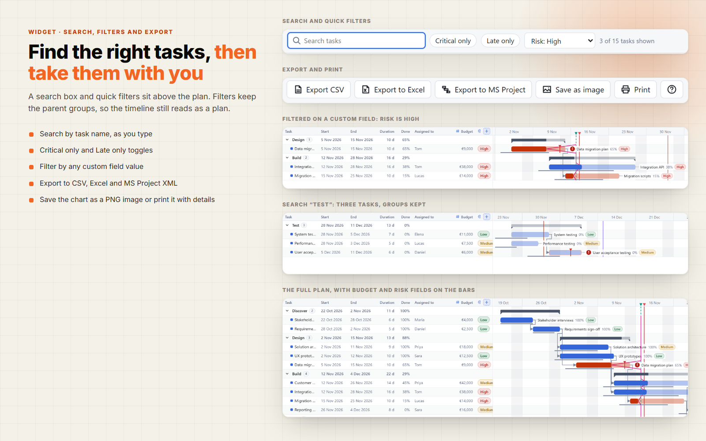 | 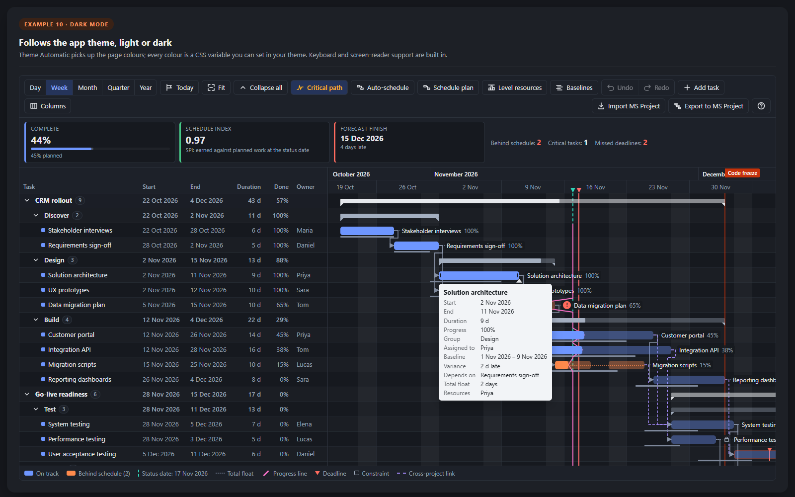 |
| **9. Search, filters and export.** Critical only, Late only, custom field filters, and CSV, Excel and MS Project export. | **10. Dark mode.** The same plan in the dark theme, with cross-project links. |
| 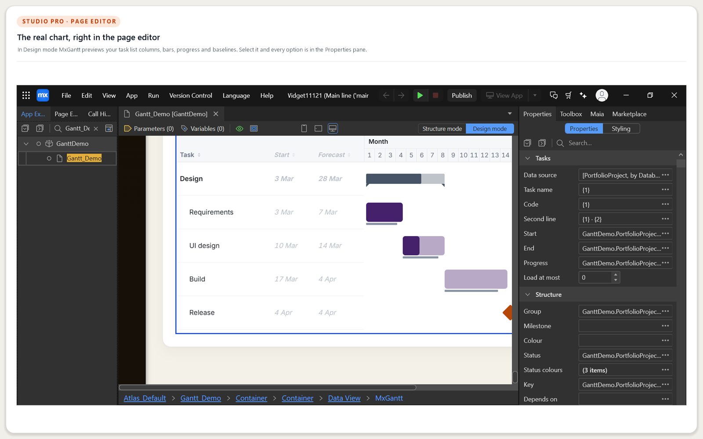 | 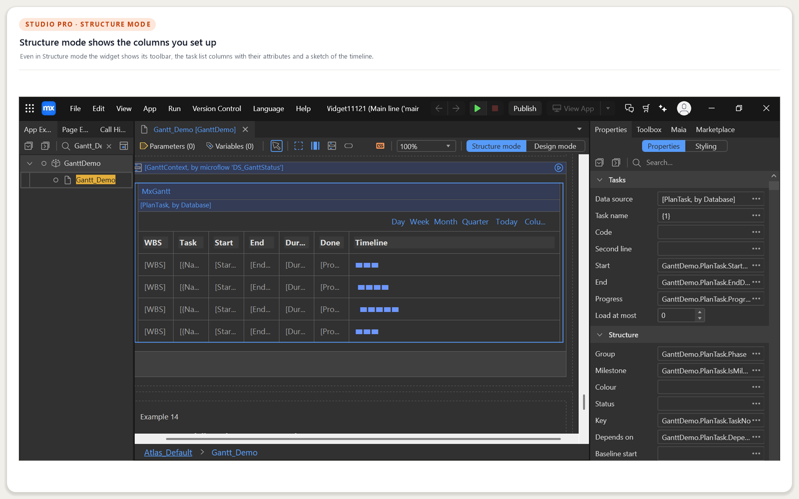 |
| **11. Studio Pro page editor.** Design mode previews the task list columns, bars, progress and baselines. | **12. Studio Pro structure mode.** The structure preview shows the configured columns and a bar sketch. |
| 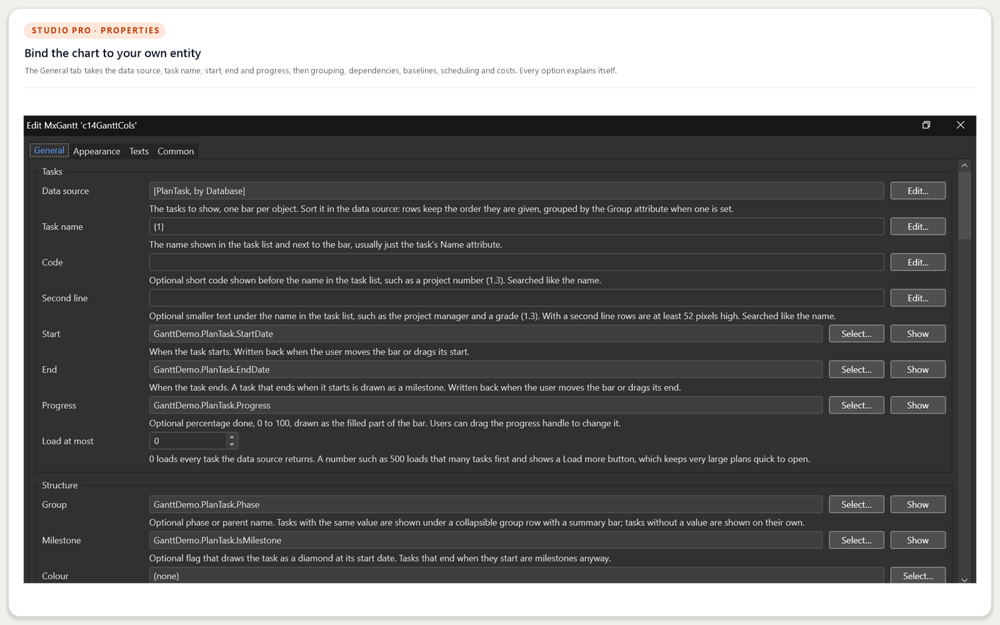 | 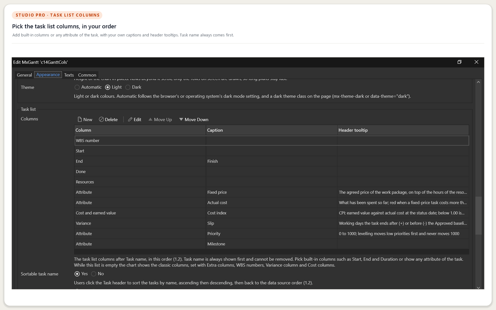 |
| **13. Properties: General.** Data source, task name, code, second line, start, end and progress. | **14. Properties: task list columns.** Built-in and attribute columns with captions and header tooltips. |

## Setting it up

1. Create an entity for tasks, for example `ProjectTask` with `Name` (String), `StartDate` and `EndDate` (DateTime), and
   optionally `Progress` (Integer 0–100), `Phase` (String or Enumeration), `IsMilestone` (Boolean), `Color` (String),
   `TaskNo` (Integer, AutoNumber or String), `DependsOn` (String), `BaselineStart` and `BaselineEnd` (DateTime) and
   `Assignee` (String or Enumeration).
2. Place **MxGantt** on a page and set the **Data source**, **Task name**, **Start** and **End**.
3. Fill in the optional attributes you have. Dependencies need both **Key** and **Depends on**. For example, a task
   whose Depends on is `3, 5` starts after tasks 3 and 5 finish.

### Dependencies

Depends on holds a comma-separated list. Each entry is a key, optionally followed by a type and a lag:

| Entry    | Meaning                                                               |
| -------- | --------------------------------------------------------------------- |
| `3`      | Finish to start: starts after task 3 ends                             |
| `3FS+2d` | Starts two (working) days after task 3 ends                           |
| `5SS`    | Start to start: starts when task 5 starts                             |
| `5SS+1w` | Starts a week after task 5 starts (a working week with a calendar)    |
| `7FF`    | Finish to finish: ends when task 7 ends or later                      |
| `9SF-1d` | Start to finish, with a day's lead: ends a day before task 9 starts   |
| `4FS+3h` | Starts three hours after task 4 ends (hours are always elapsed hours) |

A key that itself looks like a typed entry (such as `A-1`) is matched as written first. With **Edit dependencies** on,
users drag from the dot at the end of a bar onto another bar, or press **L** on a task and then **Enter** on the task
that depends on it, and remove dependencies from the task menu (right-click, the context menu key or Shift+F10).

### Working calendar and auto-scheduling

Set **Working days** to ISO weekday numbers or names, such as `1-5` or `Mon-Thu, Sat`, and **Holidays** to dates such as
`2026-12-25, 2026-12-31..2027-01-01` (a text template, so the list can come from a configuration object). Durations,
lags and the critical path then count working days, and non-working days are shaded. **Skip non-working days** keeps
dragged and nudged tasks off them. All date arithmetic works on local calendar days, so time zones and daylight saving
changes do not shift dates.

**Auto-schedule** (Off or On adds a toolbar toggle) pushes the successors of a task that moves later, and theirs, just
far enough that no link is broken. Tasks are never pulled earlier, locked tasks (Editable = false) are left alone, and
the whole batch is saved in one commit and undone in one step.

### Saving changes

The pluggable widget API cannot write to attributes that come from a data source, so MxGantt uses the Mendix client API:
it looks up the objects, sets the attributes and, with **Save changes** set to **Commit**, commits them together. With
**Change only**, the objects are changed in the client and saving is left to **On task changed**, for example a
microflow that validates the dates and commits. The widget works out which attribute is which by comparing values; when
two attributes hold the same values everywhere (a freshly baselined plan), it prefers the one whose name fits the role
and is not called Baseline or Planned. If saving a dependency reports that the attribute cannot be found (possible while
no task has a dependency yet), set **Depends on attribute name**.

**On task changed** runs for every task that was written. **On task click** runs when a bar or task name is clicked, or
Enter is pressed on a focused bar. Use the **Editable** expression to lock tasks, for example
`$currentObject/Progress != 100`, or `false` for a read-only chart.

### Editing, adding and deleting

With **Edit in task list** on, users double-click a cell or press F2 on a task to edit its name (needs **Name
attribute**), start, end, duration (in working days with a calendar), progress and predecessors. Enter saves, Tab moves
to the next cell, Escape cancels, and invalid values are explained next to the cell.

**On add task** adds an Add task button (and the Insert key). Before it runs, the suggested start (after the focused
task, or today) and end are written to **Add: start** and **Add: end** on the object of the surrounding data view, so a
nanoflow or microflow can create the task from them. **On delete task** adds Delete task to the toolbar and the task
menu (and the Delete key); it runs on the task after the user confirms.

### Columns, resources and filters

**Extra columns** take an attribute (formatted as Mendix formats it) or a text template, a caption, a width and an
alignment. **WBS numbers**, **Variance column**, **Column chooser** and **Resizable columns** are switches. With
**Remember view**, collapsed groups, shown columns and widths are kept in the browser per user, under the widget's name.

**Assigned to** takes one or more names separated by commas. **Workload panel** shows, per person, how many tasks run at
once (per day at day zoom, the busiest day of each week otherwise); more than **Tasks per person** is red. **Bar
colour** can colour bars per person.

**Search and filters** adds a search box and Critical only, Late only (unfinished after the end date, or ending after
the baseline end) and My tasks toggles. My tasks compares **My name**, for example a text template with
`$currentUser/Name`, with Assigned to.

### Configured columns

**Columns** (Task list tab) lists the columns after **Task name**, which is always the first column and cannot be
hidden. A **WBS number** column, when listed, sits right before Task name. Every other column appears in the order of
the list, and while the list is empty the chart keeps the classic layout (Start, End, Duration, Done and the switches
below), so existing pages do not change.

Each item picks a **Column**:

| Column | Shows | Needs |
| --- | --- | --- |
| Attribute | Any String, number, Boolean, Date and time or Enumeration attribute of the task | **Attribute** |
| WBS number | 1, 1.1, 1.2 ... | - |
| Start, End, Duration | The schedule, editable with Edit in task list | - |
| Done | Progress in % | Progress |
| Assigned to | The people | Assigned to |
| Resources | Assignments with units | Assignments |
| Predecessors | Depends on | Key and Depends on |
| Baseline start, Baseline end, Variance | The baseline shown and the slip in days | Baseline start and end, or Baselines (JSON) |
| Cost and earned value | One **Measure**: Cost, BAC, PV, EV, AC, CV, SV, CPI, SPI, EAC, ETC or VAC | Fixed cost, Actual cost or resource rates |

Settings per column:

-   **Caption** and **Header tooltip**. Built-in columns use their own name when the caption is empty.
-   **Format** (attribute columns): Automatic (the Mendix format), Number, Currency (uses **Currency**), Percent (45
    shows as 45%), Date, or Date and time, with **Decimals** for the number formats.
-   **Group total** (attribute columns): what group and project rows show: the sum, average, lowest or highest value
    of their visible tasks, or the number of tasks that have a value.
-   **Dynamic cell class**: an expression per task, such as
    `if $currentObject/Spent > $currentObject/Budget then 'text-danger' else ''`.
-   **Width** (0 is the column's own width), **Minimum width** for resizing, **Fill free space** (the column shares the
    leftover width with Task name), **Alignment** and **Wrap text** (two lines, then an ellipsis).
-   **Shown at first** and **Users can hide**: hidden columns can be shown with the column chooser; a column that users
    cannot hide is locked in the chooser and has no Hide in its header menu.
-   **Sortable**: a click on the header sorts ascending, then descending, then back to the data source order. Tasks are
    sorted within their groups (groups follow their first task) and empty values stay last. Sorting only changes the
    view; **Remember view** keeps it. **Sortable task name** does the same for Task name.
-   **Editable** (attribute columns): double-click a cell, or press F2 on a bar and Tab to the cell. Numbers, dates and
    text get an input, Enumeration and Boolean attributes a list of their values. The task's **Editable** still
    applies, values go through the same save path as moved bars (commit or change only, On task changed, rollback and
    Retry on failure, undo and what-if scenarios), and Integer and Long accept whole numbers only. Auto numbers cannot
    be edited. Like the other attributes the widget writes, the value is set through the Mendix client, which needs the
    attribute's name: set **Attribute name** (such as `Budget`) to be sure, otherwise it is worked out from the values.

Studio Pro shows the configured columns in the design and structure previews (columns hidden at first are faded),
hides the settings that do not apply to a column's kind, and reports duplicated built-in columns, built-in columns
whose attributes are missing, attribute columns without an attribute or caption, bad widths and decimals, and columns
users could never show. The classic **Extra columns**, **WBS numbers**, **Variance column** and **Cost columns**
settings are hidden while Columns is used.

Users can still reorder the columns by dragging headers or in the Columns panel (Task name stays first), resize them,
and add custom fields after them.

### Portfolio timeline

For a multi-year view of many projects, such as a programme board:

| Setting | Where | What it does |
| --- | --- | --- |
| **Zoom** Year | Appearance > Timeline | Years with decades above them; also in the toolbar and Fit |
| **Code**, **Second line** | General > Tasks | A code before the name (01.01) and a smaller line under it (Lukas Becker · PM400) |
| **Status**, **Status colours** | General > Structure | Bar colour per value of an attribute, plus a legend line when the value has a legend text |
| **Bar label** | Appearance > Timeline | Name and progress, Finish and progress (with **Bar label date format**, such as MM.yyyy), Custom or None |
| **Baseline style** Dashed outline | Appearance > Timeline | A dashed frame around the baseline dates |
| **Deadline style** Diamond | Appearance > Timeline | A diamond on the row at the Deadline date, such as a business need |
| **Today line style** Dashed with label | Appearance > Timeline | A dashed today line with the Today text |
| **Look** Portfolio | Appearance > Timeline | Slim bars, group headings in capitals without summary bars, quieter labels |
| **Bar legend** | Appearance > Timeline | Progress, remaining, baseline, deadline and the status colours, with the texts Legend progress, Legend remaining, Legend baseline and Legend deadline |

The progress and remaining swatches of the legend use the first Status colour, so list the normal colour first. To
show only the name in the task list, add the built-in columns you want to offer with **Shown at first** off: users can
still show them with the column chooser. **On task click** can open a page with the project's own schedule.

### Custom fields

Users add their own task list columns in the running app, and choose which columns they see. No domain model change is needed per field: two String attributes hold
everything.

**Setting it up** (General > Custom fields):

| Property                   | What to set                                                                                      |
| -------------------------- | ------------------------------------------------------------------------------------------------ |
| Custom fields              | On.                                                                                              |
| Fields                     | A String attribute (unlimited length) of the data view object around the widget, usually the project. It holds the field definitions, so everyone who opens that project sees the same fields. |
| Task values                | A String attribute (unlimited length) of the task. It holds that task's values.                  |
| Users can manage fields    | An expression: `true` lets every user add, change and delete fields; use a Boolean attribute set by the data view's microflow (for example from a role check) to limit it. Values follow each task's **Editable**. |
| On fields changed          | Runs on the data view object after the definitions changed. Point it at a microflow that commits the object; without it the fields are only saved when the page saves the object. |
| On field values changed    | Optional. Runs on a task after one of its values changed; when empty, On task changed runs.      |
| Task values attribute name | Only needed when saving reports that the attribute could not be found (all tasks still empty and the name does not contain Field, Custom or Values). |
| Most fields                | 1-100, 30 by default.                                                                            |
| First-time hint            | Shows a short "Make this plan your own" hint while a plan has no fields.                        |

Studio Pro shows a sample Risk column in the design view while Custom fields is on, and hides the other custom field
properties while it is off.

**What users can do:**

- **Add a field** with the **+** at the end of the task list header (or **Add field** in the Columns panel): name, a type
  picked from ten types with icons, type options and a live preview.
- **Ten types:** Text, Number (plain, currency with an ISO code, or percent with a small meter, 0-6 decimals), Date,
  Single select and Multi-select (coloured choices, reordered with the arrows), Checkbox, Person (avatar with initials,
  names suggested from other tasks), Link (only http, https and mailto open, in a new tab), Rating (3, 5 or 10 stars) and
  Formula (read-only).
- **Formulas** use other fields and the task's **Duration** (working days), **Done** (progress) and **Cost**, written as
  `[Budget] * [Done] / 100`, with `+ - * /`, `%`, comparisons and `ROUND`, `MIN`, `MAX`, `SUM`, `AVG`, `ABS`, `IF`.
  Formulas use stored values only (not other formulas), so they cannot form cycles.
- **Edit values in the list:** double-click a cell, or press F2 on a task and Tab to the field. Text, number, date, link
  and person cells take typed values (`12k`, `1.250,50` and `30-11-2026` are understood); select cells open a searchable
  list (arrow keys, Enter, Delete clears); checkboxes and stars change with one click. Every change is one undo step and
  works in what-if scenarios like any other edit.
- **Header menu** (the ⋯ on a custom field header): Edit field (rename, change the type, edit choices, format, show on
  bars, show in tooltip), Hide column, Delete field (with confirmation). Changing the type converts the stored values in
  one batch and shows first how many convert and how many cannot (text becomes choices, choices become text, `yes`
  becomes ticked, and so on). Deleting a field keeps its values on the tasks; adding a field with the same name brings
  them back.
- **Columns panel** (toolbar): every column (plan columns, the app's extra columns, custom fields) with a checkbox,
  search, drag handles to reorder (or Alt + Up / Down), **Show all** and **Reset**. Dragging a column header also
  reorders. With **Remember view**, order, visibility and widths are kept per user.
- Values appear in the **bar tooltip** and, per field, as **chips on the bars**; they are **searched** by the search box,
  can be **filtered** with the field filter (select, multi-select, checkbox and person values), and are included in the
  **CSV**, **Excel** (numbers stay numbers, dates stay dates) and **print / image** exports.

**The JSON contract.** Both attributes hold plain JSON, so microflows, imports and reports can read and write them.

Fields (on the project), an array:

```json
[
  { "key": "budget", "name": "Budget", "type": "number", "format": "currency", "currency": "EUR", "decimals": 0 },
  {
    "key": "risk", "name": "Risk", "type": "select", "onBar": true,
    "options": [
      { "id": "low", "label": "Low", "color": "#15803d" },
      { "id": "medium", "label": "Medium", "color": "#ca8504" },
      { "id": "high", "label": "High", "color": "#d92d20" }
    ]
  },
  { "key": "approved", "name": "Approved", "type": "checkbox" },
  { "key": "vendor", "name": "Vendor", "type": "text", "width": 150, "description": "Who delivers it" },
  { "key": "left", "name": "Budget left", "type": "formula", "formula": "[budget] * (100 - [_progress]) / 100" }
]
```

| Key           | Meaning                                                                                                   |
| ------------- | --------------------------------------------------------------------------------------------------------- |
| `key`         | Stable id used in the task values: letters, digits, `_`, up to 40. Made from the name and never changed by renames. |
| `name`        | The column header.                                                                                        |
| `type`        | `text`, `number`, `date`, `select`, `multi`, `checkbox`, `person`, `url`, `rating`, `formula`. Unknown types are read as `text`. |
| `options`     | Select and multi-select: `{ id, label, color }` in order (a plain list of labels is accepted too).        |
| `format`      | Number and formula: `plain`, `currency` (with `currency`, an ISO 4217 code) or `percent`.               |
| `decimals`    | 0-6.                                                                                                      |
| `max`         | Rating: 3-10 (5 by default).                                                                              |
| `formula`     | References are stored as `[key]`, built-ins as `[_duration]`, `[_progress]` and `[_cost]`; users see and type names. |
| `width`, `align` | Starting width in pixels (40-800) and `left`, `center` or `right`; defaults depend on the type.       |
| `onBar`       | `true` shows the value next to the bar.                                                                   |
| `inTooltip`   | `false` leaves the field out of the tooltip.                                                              |
| `description` | Help text in the header tooltip.                                                                          |

An object `{ "fields": [ ... ] }` is read as well. Broken JSON, duplicate keys and unusable entries are skipped, never
thrown.

Task values (on each task), an object keyed by field key:

```json
{ "budget": 42000, "risk": "high", "approved": true, "vendor": "Northwind Digital", "tags": ["web", "eu"] }
```

Numbers and ratings are numbers, dates are `yyyy-mm-dd`, select values are option ids (labels are accepted when
reading), multi-select values are arrays of ids, checkboxes are booleans, the rest is text. Empty values are left out;
a task without values stores an empty string. Formula results are not stored. Values written under another type are
read as well as they can be (`"12,5"` as a number, a label as a choice), so apps can fill the JSON loosely.

The values are written like dates and progress: through the Mendix client (the data source attribute itself is
read-only for widgets), then committed or only changed according to **Save changes**, with rollback and Retry on a
failed commit.

### Excel and MS Project export

**Excel export** adds Export to Excel. The workbook holds the task list as shown (filtered, all groups expanded): a row
per group in bold with its tasks indented and outlined under it (fold them with Excel's outline buttons), WBS numbers,
keys (when dependencies are set up), start and end as real dates, duration in working days (calendar days without a
calendar), progress as a percentage, predecessors as written, assignees, baseline start and end and the variance in
days. The header row is frozen and has filters.

**MS Project export** adds Export to MS Project, which saves Microsoft Project XML (MSPDI). Open it in Microsoft Project
(File, Open, choose XML format) or ProjectLibre. Groups become summary tasks, tasks get WBS and outline numbers, and
every dependency becomes a predecessor link with its type and lag: `d` lags are working days, `w` working weeks, `h`
elapsed hours. The calendar has the Working days (8:00 to 17:00) and Holidays. Each task gets a Start No Earlier Than
constraint at its planned start, so Project keeps the dates unless a link pushes a task later. Midnight starts become
8:00 and midnight ends become 17:00 on the last working day before them. Baselines are written as baseline 0, and every
name in Assigned to becomes a resource assigned to its tasks.

Both files are built in the browser and the download starts from the button click. **File name** names them, and the MS
Project file uses **Print title** (or the file name) as the project name.

### What-if scenarios

**What-if scenarios** adds a Plan a scenario toggle. While a scenario is open, every change (dragging, resizing,
keyboard moves, edits in the task list, auto-scheduled pushes and undo or redo of those) stays in the widget: nothing is
written to the objects. Changed bars get a purple outline, and a bar under the toolbar shows when the plan would end
compared with now and how many tasks moved. **Apply** writes all changes in one batch through the normal save path, so
**Save changes** and **On task changed** behave exactly as for a drag, and the whole scenario is one undo step.
**Discard** throws the changes away; pressing the toggle again asks first. Adding and deleting tasks run app actions, so
they wait until the scenario is closed. A scenario lives in the page: leaving the page discards it.

### Status date and behind schedule

**Status date line** draws a dashed line at the status date. **Highlight behind schedule** (needs Progress) colours the
bars of tasks whose progress is below the share of their working time that lies before the status date, for example a
five-day task that is two working days in and 30% done (40% expected). Milestones are behind once their date has passed
without reaching 100%. A legend under the chart explains the colours and counts the tasks behind, and the tooltip shows
done against expected. **Status date** is an expression, such as a date attribute of the surrounding data view; empty
uses the start of today. The **Variance column** shows how many days each task ends after (+, red) or before (-, green)
its baseline.

### Planning aids

| Property | Group | Default | What it does |
| --- | --- | --- | --- |
| Deadline (`deadlineAttr`) | Structure | – | DateTime. A flag on the row; bars that end later are outlined, get a warning and a tooltip line with the overrun in (working) days. |
| Total float (`showSlack`) | Planning aids | off | A dotted tail behind each bar up to its latest finish (backward pass over all link types, lags and the working calendar) and Total float in the tooltip. |
| Progress line (`progressLine`) | Planning aids | off | The MS Project style zig-zag from the status date to each task's progress point: peaks to the left are behind, to the right ahead; finished work stays on the line. Needs Progress. |
| Timeline markers (`markers`) | Planning aids | none | Date (expression), Label (text) and Colour per marker: a labelled flag in the header and a line through the chart. |
| Zoom to fit button (`zoomToFit`) | Planning aids | off | A Fit button and the F key: the most detailed zoom that shows the whole plan, scrolled to its start. |
| Project health (`showHealth`) | Planning aids | off | A strip under the toolbar: complete (duration weighted) against planned at the status date, the schedule performance index (SPI = earned / planned), the forecast finish against the latest baseline end, and counts of tasks behind schedule, on the critical path and with missed deadlines. Numbers count up when motion is on. |
| Motion (`motion`) | Timeline | Full | Full, Subtle (fades instead of growing bars and drawing arrows, no looping animations) or Off; Animations off or reduced motion always win. |

Recipe: add `Deadline` (DateTime) to the task entity; for markers use fixed dates such as
`parseDateTime('2026-11-02', 'yyyy-MM-dd')` or attributes of a ProjectSettings object around the widget. SPI below
0.85 is shown in red, below 0.95 in amber.

### Resources, levelling and costs

-   **Assignments** (String): resources with units per task, `Ann:50, Bob` (Ann half time, Bob full time; also
    `Ann [50%]`, `Ann (50%)` or `Ann 50%`). Without it, everyone in **Assigned to** works full time. With **Inline
    editing** the Resources column edits it, with validation.
-   **Resources** (an optional data source) with **Resource name**, **Max units (%)** (100 for a person, 300 for a team
    of three) and **Cost rate per hour**. Names that are not in the list count as one person without cost.
-   **Resource usage panel**: one row per resource with its load as a share of its maximum per day (busiest day per
    week at other zooms), the maximum as a dashed line and over-allocated columns in red. Over-allocated task bars get a
    dotted red underline and a tooltip line ("Over-allocates Ann on 3 days"). Click a resource to highlight its tasks.
-   **Resource levelling**: a Level resources toolbar button. It delays tasks (never splits or shortens them) until no
    resource is over its maximum: tasks are placed in dependency order, higher **Priority** (0-1000, 500 when empty)
    first, then the least total float, so tasks with float move before critical ones, and successors move with them.
    Started work, read-only tasks, priority 1000 and "must start / finish on" tasks never move. The result is shown on
    the chart with a summary (tasks moved, the new finish, how many go beyond their float, what could not be resolved)
    and Apply writes it as one change and one undo step.
-   Costs: **Fixed cost** per task plus units x working days of the segments x **Hours per working day** x the cost
    rate. **Actual cost** is optional (otherwise estimated as current cost x progress). **Currency** (EUR, USD...)
    formats the amounts.
-   **Earned value panel** at the status date: BAC, PV, EV, AC, CV, SV, CPI, SPI, EAC (BAC / CPI), ETC and VAC, the
    indices with a word (On track / At risk / Off track), and an S-curve (cumulative planned value from the baseline
    shown, earned value and actual cost up to the status date, the forecast to the estimate at completion). The chart has
    a crosshair tooltip (pointer or arrow keys) and a table of the numbers. Progress history is not stored, so EV and
    AC before the status date are reconstructed from the current schedule; at the status date they are exact.
-   **Cost columns**: Cost, EV, CPI and SPI in the task list (BAC, PV, AC, CV, SV, EAC, ETC and VAC through the column
    chooser), with group and project totals.

### Named baselines

**Baselines (JSON)** is a String attribute (unlimited length) that holds up to ten named baselines per task:

```json
[{ "name": "Approved", "start": "2026-10-05T00:00:00.000Z", "finish": "2026-10-09T00:00:00.000Z", "cost": 1200, "saved": "2026-10-01T09:12:00.000Z" }]
```

It adds a Baselines toolbar button with a panel: **Show baseline** picks the baseline the chart draws under the bars
(and that variance, health, Excel/MS Project export and earned value use); **Compare with** draws a second baseline in
amber under the first and lists the start and finish variance (and cost variance) per task; **Save current plan as
baseline** writes the current dates and costs of every editable task under a name (replacing a baseline with the same
name; one undo step); **Delete baseline** removes one after confirmation. **Baseline shown** sets the baseline that
shows first; the **Baseline start / end** attributes keep working as "Baseline (attributes)". Turn **Save
baselines** off to only show and compare.

### Split tasks

**Segments** (String, unlimited length) stores the work segments as working days after the task's start, such as
`0-2, 4-7`. The task menu (right-click, Shift + F10) has **Split task** (a one-day gap in the middle of the longest
segment) and **Join segments**; drag a later segment to move it and everything after it (the gap before it grows or
shrinks; closing it joins the segments); Alt + Left / Right moves the last segment a working day. Moving the bar keeps
the segments; resizing keeps them where they are in time. Workload, levelling and costs count only the segments.

### Constraints and Schedule plan

**Constraint type** (String or Enumeration: `ASAP`, `ALAP`, `SNET`, `SNLT`, `FNET`, `FNLT`, `MSO`, `MFO`, the long
names such as "Start no earlier than" or MS Project's numbers 0-7) and **Constraint date**. A lock icon before the task
name marks constrained tasks (red when broken), and the tooltip and screen reader label say which constraint it is and
by how much it is broken. Auto-scheduling never pushes a task before its "no earlier than" date and never moves a
"must start / finish on" task. **Schedule plan button** adds Schedule plan: a forward pass that puts every task with
predecessors as early as its links, lags, the calendar and its constraint allow (pulling tasks in as well as pushing
them out), keeps tasks without predecessors as anchors, places "as late as possible" tasks as late as their successors
allow, and reports constraints that cannot be met. It is previewed and applied like levelling.

### MS Project import

Set **On import** and **Import: JSON** (a String attribute, unlimited length, of the data view object). Import MS
Project opens a file chooser; the Microsoft Project XML file is read in the browser (no upload, no external entities),
a preview lists what it holds (tasks, links, resources, assignments, baselines, constraints, calendar), and Import
writes the plan as JSON into Import: JSON and runs On import - typically a microflow with an **Import with mapping**
(build the JSON structure from an exported example). The widget never creates objects itself. The JSON:

```json
{
  "format": "mxgantt-mspdi-import", "version": 1, "name": "Plan", "start": "...", "finish": "...",
  "calendar": { "name": "Standard", "workingDays": "1-5", "holidays": "2026-12-24..2026-12-26" },
  "tasks": [{ "uid": 2, "key": "2", "name": "Design", "wbs": "1.1", "outlineLevel": 2, "summary": false,
              "milestone": false, "start": "...", "end": "...", "progress": 50, "priority": 500,
              "constraintType": "SNET", "constraintDate": "...", "deadline": "...", "fixedCost": 250,
              "group": "Plan", "project": "Alpha", "parentUid": 1, "dependsOn": "1FS+2d",
              "assignments": "Ann:50", "baselineStart": "...", "baselineEnd": "...", "baselines": "[...]" }],
  "resources": [{ "uid": 1, "name": "Ann", "maxUnits": 100, "rate": 60 }],
  "assignments": [{ "taskUid": 2, "resourceUid": 1, "resource": "Ann", "units": 50 }],
  "stats": { "tasks": 1, "summaries": 1, "links": 1, "skippedLinks": 0, "resources": 1, "assignments": 1, "baselines": 1, "constraints": 1 }
}
```

Summary tasks become groups (and the top level a project when summaries are nested two deep); skip `summary: true`
entries when creating tasks. `dependsOn`, `assignments` and `baselines` are in exactly the format the matching
attributes use, so they can be stored as they are, with `key` in the Key attribute. Dates follow the widget's
convention (a start at 08:00 becomes midnight, a finish at 17:00 the next midnight). Links to summary tasks are left
out (counted in `skippedLinks`). **Export to MS Project** also writes assignments with units, resource
maximums and rates, constraints, deadlines, priorities, fixed costs and every named baseline (Baseline 1-10), and the
export and import are tested as a round trip.

### Portfolio

**Project** is an optional text template, usually the name over an association (`Task_Project/Project/Name`). With
projects, every project gets a collapsible summary row (darker bar) with its groups and tasks under it, WBS numbers
per project (2, 2.1, 2.1.3), and keys in Depends on are looked up in the task's own project first, so projects may
reuse task numbers; a key found only in another project makes a cross-project link (dashed purple). **Portfolio
summary** adds a table with each project's health: finish and slip against the baseline, complete, SPI, CPI,
critical, behind, missed deadlines, over-allocated tasks and cross-project links, rated On track, At risk or Off track
(SPI or CPI below 0.85, a missed deadline or a slip of more than five days is Off track). The project name jumps to its
row.

### Reliability

-   A save that takes longer than a second shows "Saving…"; a commit that fails is rolled back in the client (the
    objects get their old values back), the bars return to the saved values, and a banner says how many changes could
    not be saved, with **Retry** and **Dismiss**. No change is ever dropped silently.
-   The chart and each panel have error boundaries: a panel that fails shows a message, the chart keeps working; a
    chart that fails shows a message with Retry.
-   Text fields that are usually empty (Assignments, Segments, Baselines) are found by their name (Assign / Resource,
    Segment / Split, Baseline); set the matching **... attribute name** property when the attribute is called otherwise.

### Animations

**Animations** (on by default) makes the chart move instead of jump: zoom changes scale smoothly around the pointer or
the middle of the view, bars grow in and arrows draw in when tasks first appear, hovering a task highlights everything
it depends on and everything that depends on it, and Today scrolls smoothly. When the operating system asks for reduced
motion, nothing animates whatever the setting.

### Large plans

Only the rows on screen are drawn, and arrows, shading, header cells and workload columns only where visible, so
scrolling stays smooth with thousands of tasks. **Load at most** loads the first N tasks from the data source and shows
a Load more button.

## Keyboard

| Key                         | Action                                                          |
| --------------------------- | --------------------------------------------------------------- |
| Tab                         | Moves into the chart (one tab stop), then on to other controls  |
| Up / Down, Home / End       | Moves to the previous, next, first or last task                 |
| Left / Right                | Moves the task by one day (or one hour with hour snapping)      |
| Page Up / Page Down         | Moves the task by a week                                        |
| Shift + Left / Right        | Makes the task end earlier or later                             |
| + / -                       | Raises or lowers progress by 10%                                |
| Enter or Space              | Runs On task click; on a group row, collapses or expands it     |
| Left / Right on a group row | Collapses or expands the group                                  |
| F2                          | Edits the task in the task list                                 |
| L, then Enter               | Makes the second task depend on the first                       |
| Shift + F10 or context menu | Opens the task menu (edit, add or remove dependencies, delete)  |
| Delete                      | Deletes the task, after confirmation                            |
| Insert                      | Adds a task                                                     |
| F                           | Zooms to fit the whole plan (Zoom to fit button)                |
| Ctrl + Z / Ctrl + Y         | Undo / redo                                                     |
| ?                           | Shows all keyboard shortcuts                                    |
| Escape                      | Cancels a drag or a keyboard change that has not been saved yet |
| Alt + Left / Right          | Moves the last segment of a split task by a working day |
| Left / Right on the S-curve | Moves the crosshair from point to point |
| Alt + Up / Down             | Moves a column in the Columns panel |
| Arrows, Enter, Delete       | In a select cell: move, choose, clear |
| Space / digits              | In a checkbox or rating cell: tick, or set the stars |

Several key presses in a row are saved as one change, 0.7 seconds after the last one. Every change is announced to
screen readers. The keys for optional features only work when the feature is switched on.

## Styling

Colours are CSS custom properties on `.mxgantt`, such as `--mxgantt-bar`, `--mxgantt-group`, `--mxgantt-milestone`,
`--mxgantt-today`, `--mxgantt-conflict`, `--mxgantt-critical`, `--mxgantt-baseline`, `--mxgantt-load` and
`--mxgantt-overload`, `--mxgantt-behind`, `--mxgantt-status` and `--mxgantt-scenario`, `--mxgantt-cross`, `--mxgantt-overallocated`, `--mxgantt-constraint`, `--mxgantt-baseline2` and the S-curve series
`--mxgantt-ev-pv`, `--mxgantt-ev-ev`, `--mxgantt-ev-ac` and `--mxgantt-ev-eac` (checked for colour-blind separation in both themes), `--mxgantt-float`,
`--mxgantt-deadline`, `--mxgantt-marker` and `--mxgantt-progress-line` (classes `.mxgantt-float`, `.mxgantt-deadline`,
`.is-missed`, `.mxgantt-marker-line`, `.mxgantt-progress-line`, `.mxgantt-health` and `.mxgantt--subtle`); filled badges that
carry text use `--mxgantt-danger-fill` and `--mxgantt-on-fill`. Dark values are set on `.mxgantt--dark`. The **Theme**
property can be Light, Dark or Automatic. Automatic follows the page the widget sits on: the first mostly opaque
background colour around it (then body and html) decides, and the page is dark when that colour is dark or the page
carries the `mx-theme-dark` class or `data-theme="dark"`. Only when no background is set anywhere does it fall back to
the operating system's dark mode. A task's **Status colours** and **Colour** attribute override the bar colour. Also `--mxgantt-code` (the code before the name), `--mxgantt-need` (the deadline diamond) and `--mxgantt-baseline-frame` (the dashed baseline frame).

## Texts

Every text the widget shows is a translatable property in the **Texts** tab. Placeholders are written as `[name]`,
`[start]`, `[end]`, `[duration]`, `[progress]`, `[n]`, `[total]` and so on, and are filled in when the text is shown. To
add a text, edit `src/utils/texts.ts` and run `npm run generate:texts`.

## Development

```
npm install
npm run lint
CI=1 npm test
npm run harness   # browser harness: esbuild bundles + headless Chrome (harness/test.mjs, test-v23.mjs, test-fields.mjs)
npm run licenses  # only MIT / Apache-2.0 bundled; writes THIRD-PARTY-LICENSES.md
npm run release   # dist/1.0.0/com.mxtechies.widget.web.MxGantt.mpk
npm run sbom      # dist/1.0.0/MxGantt.sbom.cdx.json (CycloneDX 1.5)
npm run generate:typings  # typings/MxGanttProps.d.ts from the XML without a full build
```

## License

Apache-2.0, see [LICENSE](LICENSE). Copyright MX Techies 2026.
